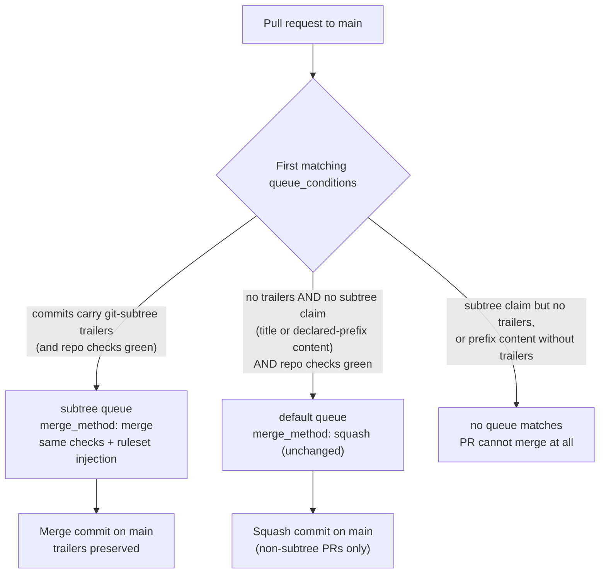
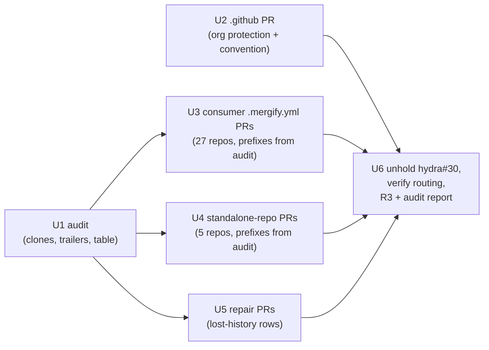

# fix: subtree PRs merge with a merge commit, never a squash (SYS-1246)

**Target:** every active `systemfsoftware` repository that merges through Mergify, plus `systemfsoftware/.github` as the org config home. This plan's home repo is the `.github` worktree; all file paths below are relative to the repo each unit targets, named per unit.

---

## Goal Capsule

- **Objective:** In every active systemfsoftware repository that merges through Mergify, a vendor-subtree PR (`git subtree add` / `git subtree pull`) can only merge through Mergify with a merge commit, a subtree PR that is not recognised from its commits cannot merge at all, the existing checks and approvals still gate every merge, and every vendor-subtree PR already merged into a main branch is audited — with real subtree history re-established where a squash destroyed it.
- **Means:** Commit-trailer recognition in Mergify queue conditions (`commits[*].commit_message` anchored trailer match), a per-repo `subtree` queue with `merge_method: merge` beside the existing `default` queue, exclusions in the `default` queue, a read-only per-repo report of merge-commit allowance (ruleset `allowed_merge_methods` + repo settings) so the owner decides how settings get applied (R3), and a git-history repair procedure for squashed subtrees (KTD1–KTD8).
- **Authority:** Ruling 9 (founder brief, 2026-10-02, recorded in Stead's AGENTS.md as Stead#4): squash-merge PRs, except subtree PRs, which merge with a merge commit. SYS-1246 is the enforcement task. Nothing in this plan weakens a check, approval, or protection.
- **Stop conditions:** Stop and report if (a) Mergify rejects `commits[*].commit_message` conditions at apply time (fall back per KTD1 contingency), (b) a re-establishment repair finds the vendored content diverged from the upstream commit in a way the PR cannot explain, or (c) an audit row cannot be classified from commit evidence — record the row as unresolved rather than guessing.
- **Execution profile:** One PR per repository, each from a `wt` worktree off `origin/main`, pushed with normal hooks. PRs are never merged, approved, or labelled `hold`-removed on PRs in archived repos by this work; merging happens through each repo's normal gates after this work lands.
- **Who finishes:** The implementing agent opens and pushes every PR and produces the report; repository owners and the Mergify queue do the merging.

---

## Product Contract

### Summary

Subtree vendoring is enforced end to end: recognition is read from the commits themselves, the merge queue physically cannot squash a subtree PR, a subtree PR without commit evidence cannot merge at all, merge-commit capability is guaranteed (and code-managed) on every Mergify repo, and the merged backlog is audited and repaired so `git subtree pull` works again everywhere.

### Problem Frame

Ruling 9 is written down but nothing enforces it. The org Mergify policy (`systemfsoftware/.github` `.mergify.yml`) sets `merge_method: squash` for every queue, and the org-wide "Queue when approved" rule puts any approved PR into the repo's first matching queue — so a subtree PR is squash-merged. A GitHub squash collapses the PR's commits, including the `git-subtree-dir:` / `git-subtree-split:` trailers `git subtree` writes, so main loses the split bookkeeping and the next `git subtree pull` breaks or duplicates the tree. Six open subtree PRs carry `hold` today because of this. Separately, GitHub rulesets exist on some repos and are managed by hand (no as-code mechanism exists anywhere in the org), and `ai-tooling` has repo settings that forbid merge commits outright.

### Requirements

- R1. In every active systemfsoftware repository that merges through Mergify, a PR whose commits carry `git subtree` trailers (`git-subtree-dir:` with a `git-subtree-split:` line) can only merge through Mergify with a merge commit. Recognition is based on the commits themselves (anchored trailer lines, not substrings — a commit that merely mentions `git-subtree-dir:` is not a subtree PR); a title, label, or the author's word is never sufficient on its own to grant the merge-commit path. Trailers are author-asserted evidence that select the merge method; they grant no authorization — every merge, in both queues, stays gated by the unchanged checks and approvals (R4).
- R2. In those repositories, a PR that is recognisable as subtree work but is not recognised as a proper subtree PR (no trailers in its commits) cannot merge at all: it enters neither the `default` queue nor the `subtree` queue. Evidence that triggers the block without trailers: a title claiming a subtree add/pull/update/sync/vendor/refresh/import, or added/modified files under a declared vendored prefix. Pure subtree removals (removed files under a declared prefix, nothing added or modified there) are exempt.
- R3. For every Mergify-merging repository, report (read-only) whether merge commits are allowed today: the ruleset `allowed_merge_methods` where rulesets exist, and the repo settings (`allow_merge_commit` / `allow_squash_merge` / `allow_rebase_merge`). The report gives the owner the per-repo facts to decide how — and whether — settings get applied; this work changes no ruleset or repo settings.
- R4. Nothing is loosened: every existing check condition, approval requirement, merge protection, and required status check applies to the new queue exactly as it applies to the existing queue. No required check is removed or made optional.
- R5. Every vendor-subtree PR already merged into a main branch is audited. Each row records: repository, PR, merge method (merge commit vs squash), and whether main carries the subtree's split history — a real trailer-bearing subtree commit reachable from the main tip, not trailer text copied into a squash commit's message (GitHub copies PR commit bodies into squash messages, so a squash merge can contain `git-subtree-dir:` lines that are not history) — yes or no.
- R6. Where a squash destroyed the split history, real subtree history is re-established in its own PR (remove the squashed copy, `git subtree add` the exact upstream commit, so the PR's commits carry the trailers again), and that PR merges with a merge commit.
- R7. Delivery: one PR per repository, each from a `wt` worktree off the repo's default branch (`main` everywhere except the five `master`-default repos: backtest-kit, comment-checker, qa-fullstack, tiktok-scraper, younna-ai-atlassian), pushed with normal hooks. The final report lists every opened PR and the audit table. The agent never merges or approves a PR.

### Key Decisions

- KD1. Subtree PRs merge with a merge commit; all other PRs squash. (ruling 9, founder brief 2026-10-02; recorded in Stead#4.) Governs R1, R6.
- KD2. Recognition lives in the commits, not in author-typed metadata. (SYS-1246 requirement; research confirmed Mergify evaluates `commits[*].commit_message` natively, so no title/label routing survives.) Governs R1, R2.

### Scope Boundaries

- Archived repositories (symphony-effect, Stead, younna-ai-master, control-plane, github-selfhosted-runner, effect-ai, systemfsoftware-old, essentials, and any other archived repo found in the audit) are audit/report-only — their configs cannot change.
- `systemfsoftware/.github` itself keeps hand-merging: it has no merge queue today (no `queue_rules` of its own), and adding queues to the org file would leak to consumers or change `.github`'s merge flow. Documented, not changed.
- Onboarding non-Mergify repos (billing, stryker-js-effect, are-the-types-wrong-effect, systemfsoftware-com, …) to Mergify is out of scope; their held subtree PRs stay held until that happens (KTD8).
- No ruleset or repo settings are changed by this work (R3, KTD4): how merge-commit allowance gets applied is the owner's decision, informed by the per-repo read-only report. `workstation/tooling/github-settings` is not extended (operator steer 2026-11-09).
- Enforcement boundary: Mergify's automated merge flow only. Repo settings and rulesets still permit squash today, so any user with write access can squash-merge from the GitHub UI or API outside Mergify — the report must not claim more than that; removing hand-merge capability is a settings/ruleset decision that belongs to the owner (R3's report).
- Admin/owner bypass of rulesets remains possible for the same reason.
- GitHub code search is not used for the audit; ground truth comes from local clones (OP8).

### Acceptance Examples

- AE1. A PR whose commits contain the anchored `git-subtree-dir:`/`git-subtree-split:` trailer lines, with the repo's usual checks green and Kiro approval in, auto-queues into the `subtree` queue and merges with a merge commit. Trailer commits stay intact on main. (In the five `master`-default repos the org auto-queue rule's `base = main` gate never matches, so entry there is via the `@mergifyio queue` command — same as every PR in those repos today; the queue routing itself is identical.)
- AE2. A PR titled like a subtree update with no trailers matches no queue, cannot merge, and its failing org protection names the missing evidence; a prefix-content PR with a neutral title likewise matches no queue and cannot merge (no named check for that variant — KTD5's recorded limitation).
- AE3. An ordinary PR (no trailers, no subtree claim) queues into `default` and squash-merges exactly as today.
- AE4. A PR that only removes files under a declared vendored prefix (no added/modified files there) still queues into `default` and merges as a squash.
- AE5. For a merged PR where squash destroyed the trailers, its repair PR re-adds the vendored tree from the exact upstream commit, its commits carry trailers, it merges with a merge commit, and a trailer-bearing commit for that prefix is then reachable from the main tip.

---

## Planning Contract

### Key Technical Decisions

- KTD1. Recognition uses Mergify's native commit-message conditions on anchored trailer lines: `commits[*].commit_message ~= (?m)^git-subtree-dir: \S+$` **and** `commits[*].commit_message ~= (?m)^git-subtree-split: [0-9a-f]{40}$` (documented attribute; `commits` is a list of Commit with `commit_message` addressable per commit, `~=` matches any element; Mergify regexes are Python re, so `(?m)` works). Anchoring matters both ways: a bare `git-subtree-dir:` substring would route any PR whose commit merely *mentions* the trailer — including this plan's own config PRs — into the merge-commit queue, and requiring both the dir and the 40-hex split line reflects what `git subtree` actually writes. No CI workflow, no labels, no title-based grant. *Contingency:* if the condition is rejected by Mergify's config validation at first apply, fall back to a shared detection workflow that posts a `subtree` check run (success = trailers present) and key queue conditions on `check-success`/`check-neutral` for that check; this fallback is the same commit-based evidence, one more moving part. *Directive challenged:* commit-based recognition was ordered by the request; research found it directly expressible in queue conditions, so no cheaper-but-weaker alternative was taken.
- KTD2. Two queues per repo, disjoint conditions, `subtree` first: `subtree` (queue + merge conditions = repo's existing checks, `merge_method: merge`) and `default` (existing checks **plus** the R2 exclusions, `merge_method` inherits the org default squash). Mergify routes a PR to the first queue whose `queue_conditions` match; a miss keeps the PR out of every queue, which is exactly R2. The existing pattern is `systemfsoftware/workstation` `.mergify.yml` (standalone, `merge-commit` + `default` queues); this plan replaces its label router (KTD3) and replicates the shape across extends-consumers.
- KTD3. Five repos are standalone (no `extends: .github`; verified from each config 2026-11-09): workstation, younna-ai, workflows, dropship-crew, frontend. Three of them already route author-applied `queue/merge-commit` labels to a `merge: merge` queue. The label cannot remain a grant path for subtree PRs under KD2, so: workstation, workflows, and dropship-crew (whose labels are subtree-purpose — "Subtree vendoring PRs must keep their history") swap the label condition for the anchored trailer condition and gain the R2 exclusions on `default`. frontend has no merge-commit queue at all: it gains the standard `subtree` + guarded `default` shape in its own structure. younna-ai is the documented exception: its `merge-commit` queue explicitly serves "Subtree, reformat and history PRs" per younna-ai's AGENTS.md (Merging), so its queue gains the trailer condition as an **or** beside the existing label (subtree PRs are recognised from commits; reformat/history PRs keep the pre-ruling label path) and its `default` queue gains the R2 exclusions. Removing the reformat/history label grant is ruling-9 territory beyond SYS-1246's ask — flagged in the U6 report and the Linear comment for Ryan to decide.
- KTD4. R3 is reporting-only: the plan reads each repo's ruleset `allowed_merge_methods` and repo merge settings via the REST API and publishes the table; it mutates nothing. *User-directed (operator, 2026-11-09, superseding the planning draft):* do not build a second settings mechanism and do not extend `workstation/tooling/github-settings` for this — that stack covers only workstation and workflows, has no CI that applies it, and its local apply state was lost, so a declared change would sit unapplied until hand-run as root. The per-repo allowance facts are already researched (Appendix: all existing rulesets' `pull_request` rules include `merge` in `allowed_merge_methods`; 17 of the 33 repos have no ruleset and rely on repo settings, all allowing merge commits except `ai-tooling`, whose `allow_merge_commit: false` is the one blocker); U6 re-reads the live state at report time and publishes it for the owner's decision.
- KTD5. The guards of R2 are **queue-condition exclusions** in the `default` queue — enforcement, not reporting — each with a removal carve-out: negated trailer match; negated claim-title regex requiring a claim verb and the word "subtree" with word boundaries — `(?i)\b(add|pull|update|sync|vendor|refresh|import)\b[^.]*\bsubtrees?\b|\bsubtrees?\b[^.]*(\badd\b|\bpull\b|\bupdate\b|\bsync\b|\bvendor\b|\brefresh\b|\bimport\b)` — which excludes removal-led titles (`\bvendor\b` cannot match inside "vendored", so "remove the vendored X subtree" and the org's historical removal/release titles — systemfsoftware#379/#401, comment-checker#42, stryker-js-effect#332, younna-ai registry release PRs — pass to `default`); negated `or:` of `added-files ~= ^<declared prefixes>` and `modified-files ~= ^<declared prefixes>` (removed-files never matches, so pure removals pass). Declared prefixes come from the audit (U1) and live in the repo's own `.mergify.yml` beside its check names. The guards are exclusions only — they can never route a PR to a faster merge, so they cannot loosen anything (R4). *Why queue conditions and not `merge_protections` for enforcement:* a protection failing reports but the org "Queue when approved" rule and `commands_restrictions` can still queue a PR; only queue conditions decide whether any queue accepts the PR, and R2 requires that no queue accepts it. Mergify's `extends` semantics (sharing doc: rules in `queue_rules`/`merge_protections` merge by name; a local rule is never overwritten by the extended config) make a **diagnosability** layer safe: U2 adds one org-wide `merge_protections` entry — apply to PRs whose title claims subtree work (the same bounded regex), succeed only when a commit carries the anchored trailer pair — so an author sees a named failing check instead of a bare "no queue matched". Prefix guards stay per-repo (org can't know prefixes); consumers never add same-named protections. Limitations recorded: trailers are author-asserted — a deliberate author can type a trailer pair onto a hand-edited vendored tree and take the merge-commit path; the fences it cannot cross are the unchanged checks and approvals (R4), and the forged split sha is detectable by the U1-style audit anytime; a trailer-stripped PR with a neutral title outside declared prefixes is indistinguishable from a normal PR; a PR merely *about* subtrees (e.g. docs titled "update subtree docs") trips the title claim and needs a retitle — the guard fails closed on purpose, because blocking an innocent title is cheap and passing a stripped subtree PR is the exact loss this task exists to prevent.
- KTD6. Audit ground truth (U1) is clone-based, not search-based: for every active repo, a blobless clone (`git clone --filter=blob:none`), `git log --grep='^git-subtree-dir:'` on the main branch for live prefixes, PR-level merge method from the merge commit's parent count (2 parents = merge commit, 1 = squash/rebase), and per-PR history presence from whether a real trailer-bearing subtree commit for that PR's prefix is reachable from the main tip **excluding the PR's own squash commit** — GitHub copies PR commit bodies into squash messages, so a squash merge (e.g. younna-ai#486) can carry `git-subtree-dir:` lines at line start that are message text, not history; a trailer found only in a one-parent PR squash commit classifies the row `squash-lost`. The org PR search (title `subtree|vendor`) seeds the candidate set; the clone scan is the completeness backstop for PRs whose titles lack those words. Repair procedure (U5), matching the org's squash vendoring convention: `git rm -r <prefix>`, then `git subtree add --squash --prefix=<prefix> <upstream-url> <split-sha>` (without `--squash` the repair would merge the upstream repo's full history into main — for an external upstream like Effect-TS/effect that is thousands of commits). The split sha comes from `subtrees.toml` or the original PR's trailers/body; upstream tags may cross-check it but never select it. Before pushing: content-diff the removed tree against the upstream split commit — **a non-empty delta is a stop, not a footnote**: the row goes `unresolved` with the delta recorded in the report (Goal Capsule stop condition b). Prior art: systemfsoftware#88 repaired a subtree vendored from the wrong commit. *Verified by scratch probe (2026-11-09, throwaway repos):* `subtree add` (squash and non-squash), `subtree pull --squash`, and the `rm` + `subtree add --squash` repair all produce commits carrying `git-subtree-dir`/`git-subtree-split`; with `--squash` the trailers land on the auto-generated `Squashed '<prefix>/' content from commit <sha>` commit — not on the `-m` commit — so recognition and post-merge checks must match trailers on any PR/main commit, which `commits[*]` and `--grep` already do.
- KTD7. Delivery mechanics: one PR per repository from a `wt` worktree off `origin/main`, pushed with normal hooks (`wt` and the husky pre-push hook are both installed on this workstation). *Directive challenged:* considered bundling the 31 consumer config edits into fewer PRs to cut review overhead — rejected because the request fixes the delivery shape (one PR per repository) and per-repo review keeps each queue change atomic. The agent never merges (AGENTS.md rule; queue + Kiro do that).
- KTD8. The six held PRs: `hydra#30` is unheld once hydra's config lands (its queue then routes it to a merge commit automatically). The four holds in non-Mergify repos (`stryker-js-effect#354`, `systemfsoftware-com#7`, `are-the-types-wrong-effect#77`, `billing#8`) stay on `hold`: nothing lands there, and unholding would re-expose them to a hand squash. `symphony-effect#194` is in an archived repository — no action possible, report-only. This is the conservative reading of "carry hold until this lands"; the alternative (unhold all six with hand-merge instructions) is recorded as rejected because it re-opens the squash hazard this task exists to close.

### High-Level Technical Design

PR routing after this plan, per Mergify repo (U3/U4 shape; `default` keeps every check condition it has today, shown compressed):



Sequencing across units:



### Assumptions

Recorded as un-validated agent bets (scoping confirmation skipped via `--no-wait`):

- `.github` itself is treated as a non-queue repository (out of scope per Scope Boundaries; not user-confirmed); if Ryan wants `.github` PRs queue-merged too, that is a small follow-up inside the org file's own config block.
- The claim-title regex and the removal carve-out verbs are a convention; titles that neither claim nor deny subtree work are treated as ordinary PRs.
- Mergify's SaaS build accepts `commits[*].commit_message` conditions today (docs current as of 2026-11-09); first apply confirms, with the KTD1 fallback if not.
- The audit's candidate seeds (PR title search `subtree|vendor` in title) may miss oddly-titled subtree PRs; the blobless-clone trailer scan over every active repo is the backstop that makes U1 complete regardless.

### Sequencing

U1 first; U2 is independent of U1's prefix output; U3, U4, and U5 consume U1's inventory. No PR depends on another *repo's* PR merging — every config change is self-contained per repo, so after U1 lands the config PRs can be pushed in any order and reviewed in parallel. The one in-repo dependency: a repair PR (U5) in a Mergify repo opens held and unholds only after that repo's config PR is observed merged (U5 Dependencies). U6 runs last and owns the post-merge verification follow-ups (repair reachability, queue routing on real PRs).

### Sources / Research

- Mergify conditions reference (attributes `commits`, `commit_message`, `check-neutral`, list operator semantics): https://docs.mergify.com/configuration/conditions/
- Mergify Commit data type (`commit_message` addressable per commit): https://docs.mergify.com/configuration/data-types/
- Mergify queue rules (first matching queue, no fallback, per-queue `merge_method`, `branch_protection_injection_mode`): https://docs.mergify.com/merge-queue/rules/
- Mergify `extends` semantics (rules merge by name; local rules never overwritten; validation on every push; `mergify config validate`/`simulate` CLI): https://docs.mergify.com/configuration/sharing/ and https://docs.mergify.com/configuration/file-format/
- Existing two-queue precedent and the four other standalone configs (verified 2026-11-09 from each file): `systemfsoftware/workstation`, `systemfsoftware/younna-ai` (3 queues; merge-commit queue serves "Subtree, reformat and history PRs" per its AGENTS.md), `systemfsoftware/workflows`, `systemfsoftware/dropship-crew`, `systemfsoftware/frontend` (no merge-commit queue).
- Org policy: `systemfsoftware/.github` `.mergify.yml` (extends contract, `defaults.queue_rule.merge_method: squash`, "Queue when approved").
- Existing ruleset-as-code mechanism (left untouched per operator steer 2026-11-09): `workstation/tooling/github-settings` (Alchemy; declares workstation + workflows merge settings and `main` rulesets only; no applying CI; local apply state lost).
- Vendoring convention: `systemfsoftware/constitution` README (`git subtree add/pull --squash --prefix=vendor/constitution`); starter-kit uses `repos/*` prefixes + `subtrees.toml` registry (starter-kit#102).
- Merged subtree PR evidence: starter-kit#102 (merge commit, 2 parents, trailers on main), org-wide search `is:merged subtree in:title` (~50 candidates across ~25 repos), younna-ai#486 (squash merge whose squash commit message carries copied trailer text — the KTD6 exclusion case).
- Ruleset state snapshot (2026-11-09, read-only research): all existing rulesets' `pull_request` rules set `allowed_merge_methods` including `merge`; `ai-tooling` repo settings `allow_merge_commit: false`; 17 of the 33 Mergify repos have no ruleset (repo settings allow merge commits everywhere except ai-tooling). Full inventory in the Appendix; U6 re-reads live state for the report.

---

## Implementation Units

### U1. Audit merged vendor-subtree PRs org-wide

- **Goal:** Produce the complete audit table (repository, PR, merge method, subtree history present yes/no) and the per-repo inventory (declared prefixes, upstream URL + split sha, repair-needed flag) that U3, U4, and U5 consume.
- **Requirements:** R5; feeds R2 (prefix declarations) and R6 (repair set).
- **Dependencies:** none (first unit).
- **Files:** external session scratch only (no repo files); results land in the U6 report and the PR bodies of U3/U5.
- **Approach:**
  1. Enumerate active repos and their main branches via `gh api orgs/systemfsoftware/repos` (archived repos flagged, not scanned further).
  2. Seed candidates from PR search (`is:merged` + `subtree|vendor` in title, all repos, paginated).
  3. Blobless-clone and scan **every** active repo (the completeness backstop; the PR search is only a seed): `git log --grep='^git-subtree-dir:'` on the repo's default branch for live prefixes; tree-vs-history check for vendored dirs with no real trailer commits (squash-destroyed history). Trailer-less vendored dirs are found without depending on titles: read the repo's own registry (`subtrees.toml` where present) plus the conventional `vendor/` and `repos/` prefixes; for each such dir with no real trailer commit, identify the introducing PR via `git log --diff-filter=A -- <dir>` and the `(#N)` suffix in commit subjects. (Queue squashes use `commit_message_format: title/body from the PR`, so they leave no trailer text on main — only this directory check catches them.)
  4. Per candidate PR: merge method from merge-commit parent count; history present = a real trailer-bearing subtree commit for that PR's prefix reachable from the main tip, excluding the PR's own squash commit (KTD6).
  5. Classify each row by the two R5 columns — merge method (merge commit vs squash) and history present (yes/no) — plus status flags `archived` / `unresolved`; `squash-lost` names the squash + history-no combination and is the U5 trigger.
- **Patterns to follow:** OP8 (local clones, no GitHub code search); systemfsoftware#88's repair evidence trail.
- **Test scenarios:**
  - Starter-kit#102 row: merge method "merge commit", history present "yes" (verify trailer commit `e164e50d` reachable from main tip) — validates parent-count and trailer-reachability logic against a known row.
  - A repo whose main has a vendored dir but zero `git-subtree-dir:` commits in history classifies `squash-lost` (this is the U5 trigger).
  - A PR in an archived repo classifies `archived` and produces no repair task.
- **Verification:** Every active repo scanned (count reported); every candidate PR has a row with all four columns filled; spot-check three rows by hand against the API before accepting the table.

### U2. `systemfsoftware/.github` PR — org-wide diagnosability protection + subtree convention

- **Goal:** Land the org-level "Subtree claim needs subtree history" merge protection (named failing check for title-claimed subtree PRs without trailers) and document the consumer subtree-queue convention in the org policy file. No settings, rulesets, or script.
- **Requirements:** R2 (diagnosability), R4; advances R7 (one PR for this repo).
- **Dependencies:** none (org protection is self-contained; inherits into every extends-consumer automatically once merged).
- **Files:** `.mergify.yml` (one new `merge_protections` entry — `if`: not a queue branch and title matches the KTD5 claim regex; `success_conditions`: a commit matches the KTD1 anchored trailer pair — plus a short comment documenting the consumer convention: a `subtree` queue keyed on the anchored trailer pair and the R2 exclusions on `default`; nothing else in the org file changes), `README.md` (one line pointing consumers at the subtree-queue convention).
- **Approach:**
  1. Add the protection with the exact KTD1/KTD5 conditions (same bounded claim regex as the consumers' exclusions, so consumers cannot drift from the org).
  2. Add the convention comment near `defaults.queue_rule` explaining that consumers add a `subtree` queue and the `default` exclusions, with a pointer to this plan.
  3. No `queue_rules`, no `defaults` changes — org queues would leak to consumers or enable checkless merges (KTD5, Assumptions).
- **Patterns to follow:** the org file's existing `merge_protections` entries (name/description/if/success_conditions shape, `*not_queue_branch` anchor).
- **Test scenarios:**
  - YAML parses; the Mergify configuration check on this PR validates the file (Mergify validates config changes on every PR, Checks tab).
  - Condition-matrix cases: title-claim PR with trailers → protection passes; title-claim PR without trailers → protection fails with its name visible; ordinary title → protection not applied.
  - `mergify config simulate` against an open PR in a consumer repo, when the CLI is available, shows the new protection evaluating.
- **Verification:** PR's Mergify configuration check green; PR opened from a `wt` worktree with hooks on; the protection appears in a consumer repo's effective protections after merge (spot-check via a consumer PR's Mergify summary).

### U3. Consumer `.mergify.yml` PRs — trailer-keyed `subtree` queue + guarded `default` queue (27 repos)

- **Goal:** In every extends-consumer repo, a `subtree` queue (merge commit, anchored-trailer recognition, unchanged checks) and a `default` queue that rejects trailer-bearing, claim-titled, and prefix-content PRs.
- **Requirements:** R1, R2, R4; advances R7.
- **Dependencies:** U1 (declared prefixes per repo; repos with no vendored prefixes omit the prefix condition).
- **Files:** `.mergify.yml` in each of the 27 verified extends-consumers (hydra, effect-endgame-starter-kit, systemfsoftware, ai-tooling, comment-checker, qa-fullstack, worktrunk-scripts, agent-graph, systemf-review-agent, agent-inbox, xstate, emulate, api-extractor-effect, gritlint, effect-readiness, effect-e2e, effect-microvm, hex-schema, discern, rx-effect, effect-memfs, npm-package, effect-daemon, backtest-kit, tiktok-scraper, younna-ai-atlassian, younna-ai-business — plus any audit-discovered consumer). Standalone repos are U4's.
- **Approach:**
  1. Read the repo's current `.mergify.yml` first; confirm `extends: .github` (a repo found to be standalone moves to U4 treatment); preserve its check names and condition structure exactly.
  2. Add the `subtree` queue before `default`: `merge_method: merge`, `queue_conditions` = the two KTD1 anchored trailer conditions + the repo's existing check conditions; `merge_conditions` = the repo's existing merge conditions unchanged.
  3. Extend `default.queue_conditions` with the three R2 exclusions (KTD5), prefixes from U1.
  4. No other key changes: `defaults`, `merge_queue`, protections, priority rules untouched (R4); no local `merge_protections` additions (the org-level protection from U2 already covers title claims; local protections would duplicate or shadow it).
- **Patterns to follow:** the org file's quoted-condition style; workstation's two-queue shape; each repo's own condition comments.
- **Test scenarios:**
  - YAML parses; every condition string in the new queues also appears (or is deliberately absent and commented) in the pre-edit file's conditions — diff review shows checks unchanged.
  - AE1–AE4 against the condition matrix: trailer PR → `subtree` only; claim/prefix-no-trailer PR → neither queue; plain PR → `default` only; pure-removal PR → `default`; a commit merely mentioning `git-subtree-dir:` in prose (this plan's own config PRs) → `default` (anchored regex must not match).
  - Historical titles pass to `default`: "remove the oh-my-pi vendored subtree" (systemfsoftware#379), "remove six vendored subtrees" (#401), "remove vendored subtrees and repos directory" (comment-checker#42), "refresh the vendored tarballs" (younna-ai release style).
- **Verification:** per repo — YAML parse locally; the PR's own Mergify configuration check validates the edited `.mergify.yml` before merge (Mergify validates config changes on every PR and reports in the Checks tab); after merge, the repo's held/open subtree PRs' Mergify check summary shows `subtree` queue matching (U6 verifies on hydra#30); `mergify config simulate` against a real open PR when the CLI is available; PR from `wt` worktree, hooks on.
- **Execution note:** This is config-only; proof is the post-merge Mergify check summary on a real subtree PR, so U6's verification is part of this unit's acceptance.

### U4. Standalone-repo PRs — commit recognition replaces labels (workstation, workflows, dropship-crew), standard shape (frontend), extended grant (younna-ai)

- **Goal:** The five standalone configs (KTD3) get trailer-based subtree recognition and the R2 guards, each in its own structure: three swap their `queue/merge-commit` label for the anchored trailer pair, frontend gains the standard two-queue shape, younna-ai keeps its broader label for reformat/history PRs and adds trailers as an or-condition.
- **Requirements:** R1, R2, R4; advances R7.
- **Dependencies:** U1 (declared prefixes; config otherwise standalone).
- **Files:** `.mergify.yml` in `systemfsoftware/workstation`, `systemfsoftware/workflows`, `systemfsoftware/dropship-crew`, `systemfsoftware/frontend`, `systemfsoftware/younna-ai`.
- **Approach:**
  1. workstation, workflows, dropship-crew: in the `merge-commit` queue, keep name, `merge_method: merge`, batching, checks; replace `- label = queue/merge-commit` with the two KTD1 anchored trailer conditions; in `default`, **remove** the now-dead `- -label = queue/merge-commit` condition (a label-only PR would otherwise match neither queue and be stuck — the negated trailer exclusion replaces it as the disjointness guard) and add the R2 exclusions; update the header comment (recognition is commit-based; the label is no longer read for subtree routing). younna-ai keeps its negated label alongside the new negated trailer exclusion, because its label path stays.
  2. frontend: add the standard `subtree` queue (trailers + its existing `check-success = check` and kiro conditions) and extend `default` with the R2 exclusions, mirroring its existing single-queue structure.
  3. younna-ai: add the anchored trailer conditions as an **or** beside `- label = queue/merge-commit` in the `merge-commit` queue; add the R2 exclusions to its `default` and `deploy-fix` queues' exclusion set (a subtree-claiming PR must not squash-merge via `deploy-fix` either); leave the label's reformat/history routing intact and flagged (KTD3).
  4. Keep every repo's ruleset-bypass notes and header documentation accurate (workstation/workflows document `dismiss_stale_reviews_on_push` and the Mergify bypass actor — untouched).
- **Patterns to follow:** each file's own existing structure and comment style (workstation is the reference shape).
- **Test scenarios:** U3's full condition matrix against each repo's condition set, plus per-repo cases: a label-only PR without trailers now lands in `default` in workstation/workflows/dropship-crew (deliberate behavior change, recorded in each PR body); a younna-ai reformat PR keeps routing to `merge-commit` by label; a younna-ai trailer PR without label reaches `merge-commit`; a younna-ai deploy-fix PR with a subtree claim and no trailers matches no queue.
- **Verification:** YAML parse; each PR's Mergify configuration check green before merge; post-merge observation on the next real subtree PR per repo; PRs from `wt` worktrees, hooks on.

### U5. Re-establish lost subtree history (one PR per affected repo)

- **Goal:** For every `squash-lost` row from U1, restore real subtree history so main carries `git-subtree-dir:`/`git-subtree-split:` again and `git subtree pull` works.
- **Requirements:** R6; advances R5 (rows close as repaired).
- **Dependencies:** U1 (repair set + upstream shas). Within a repo, a repair PR depends on that repo's U3/U4 config PR being merged first: until then the repo's live queue would squash the repair (Kiro approval auto-queues it), destroying the trailers a second time. Mergify-repo repair PRs therefore open with the `hold` label, and U6 removes it only after that repo's config PR is observed merged; non-Mergify repos get an explicit merge-with-merge-commit instruction in the PR body instead.
- **Files:** the vendored prefix directory in each affected repo (deleted then re-added by `git subtree`); no config files.
- **Approach:**
  1. `wt` worktree off the repo's default branch (`origin/main`, or `origin/master` in the five master-default repos).
  2. Content check before anything is pushed: diff the removed tree against the upstream split commit (sha from `subtrees.toml` or the original PR's trailers/body; upstream tags cross-check only). **A non-empty delta is a stop**: the row goes `unresolved` with the delta recorded in the report (Goal Capsule stop condition b) — a "history repair" PR must be content-neutral; it never slips new upstream code onto main.
  3. Commit `git rm -r <prefix>` as one commit; `git subtree add --squash --prefix=<prefix> <upstream-url> <split-sha>` as the second (org convention; its squashed-content commit carries the trailers; without `--squash` the upstream repo's full history would merge into main).
  4. Push with hooks on; PR body links the audit row, the squashed PR, and the upstream sha; non-Mergify repos get an explicit merge-with-merge-commit instruction in the body.
- **Patterns to follow:** constitution README's vendoring commands; systemfsoftware#88's repair-PR structure.
- **Test scenarios:**
  - AE5 on each repair PR: after merge, `git log --grep='git-subtree-dir: <prefix>'` on main returns the re-add commit, and `git subtree pull` on a fresh clone fetches without error.
  - A repair whose upstream sha cannot be matched to the squashed content is not pushed — recorded `unresolved` in the report (stop condition).
- **Verification:** per repaired repo, pre-push evidence only — local `git subtree pull --squash` dry run against a fresh clone; the PR's commits shown to include the trailer-bearing squashed-content commit; PR from `wt` worktree, hooks on. Post-merge confirmation ("trailer commit reachable from main tip") is U6's follow-up once the owner merges; until observed, the row reads "repair PR open — pending merge".

### U6. Unhold, verify routing, report

- **Goal:** Land the flow end to end and produce the final report: every PR, the audit table, and the R3 per-repo merge-commit-allowance table.
- **Requirements:** R3, R5, R7; closes SYS-1246's "done when".
- **Dependencies:** hydra's U3 config merged (per KTD8 — the only merge-dependent step); U1 table final; U5 PRs opened; all other unit PRs opened, with merge status tracked in the report per R7 (the agent never merges; owners and queues do).
- **Files:** none (Linear issue comment + final chat report).
- **Approach:**
  1. If hydra's U3 config PR has merged: verify hydra#30's Mergify check summary matches the `subtree` queue, then remove `hold` (KTD8). If it has not merged when the report is due: hydra#30 stays held and the report lists it as "held pending hydra config merge", with the unhold named as the owner's (or a follow-up run's) step — the agent never merges (same deferral treatment as the repair rows).
  2. Re-read live state for the R3 table: per Mergify repo, ruleset `allowed_merge_methods` (where rulesets exist) and repo merge settings (`allow_merge_commit`/`allow_squash_merge`/`allow_rebase_merge`); flag repos where merge commits are not allowed today (ai-tooling per research; re-verify at report time).
  3. Post to SYS-1246: the audit table (repaired rows marked "repair PR open — pending merge" until U6's own post-merge check observes a trailer commit reachable from the main tip), the PR list with merge status, the R3 allowance table, the younna-ai reformat/history label question (KTD3), and the held-PR status per KTD8.
  4. Final chat report: PR list (repo, PR, one-line change) + audit table (repository, PR, merge method, history present yes/no) + R3 table.
- **Patterns to follow:** SYS-1246's "done when" checklist as the report skeleton.
- **Test scenarios:**
  - AE1 observed on hydra#30's check summary after unhold (queue match visible before any merge happens).
  - Every audit row appears in the report; every opened PR appears in the PR list; every Mergify repo appears in the R3 table; counts reconcile.
- **Verification:** the report itself; Linear comment permalink recorded in the session summary.

---

## Verification Contract

| Gate | Where it runs | Command / evidence |
| --- | --- | --- |
| YAML validity of every edited `.mergify.yml` | locally, per repo worktree | parse each edited file before committing |
| Condition preservation (R4) | per PR review | diff shows existing check/merge conditions unchanged, additions only |
| Merge-commit allowance facts (R3) | U6, read-only | REST reads of each Mergify repo's ruleset `allowed_merge_methods` + repo merge settings, published as the per-repo table |
| Queue routing (AE1/AE2) | per config PR, pre- and post-merge | `mergify config simulate <pr-url>` (CLI, when available) shows `subtree`/`default`/no-queue matches per scenario; post-merge the real held PR's Mergify check summary names the `subtree` queue |
| Config validation (every edited `.mergify.yml`) | each PR's Checks tab | Mergify's automatic configuration check green on the PR |
| History repair (AE5) | pre-push: U5; post-merge: U6 | U5 pre-push: local `git subtree pull --squash` dry run + PR commits show the trailer-bearing squashed-content commit; U6 post-merge: trailer commit reachable from main tip (rows read "pending merge" until observed) |
| Local scope (OP28) | this host | YAML parse + read-only API checks; no e2e suites; off-host acceptance = each repo's own CI + Kiro gates on the opened PRs |

---

## Definition of Done

- Every one of the 32 queue-bearing Mergify repos (27 consumers + 5 standalone) has the trailer-keyed `subtree` queue and the guarded `default` queue; each landed as its own PR from a `wt` worktree off `origin/main`, hooks on, never merged by the agent.
- `.github` PR merged or open carrying the org-level "Subtree claim needs subtree history" protection and the convention documentation; no check, approval, protection, ruleset, or repo setting loosened or changed anywhere (R4 diff-audited).
- Audit table complete for every active repo, every row classified by merge method and history-present plus status flags, unresolved rows named as unresolved (stop condition honored).
- One repair PR per `squash-lost` repo, each carrying trailer-bearing commits and an instructed merge-commit merge; unpushed repairs recorded `unresolved` with their content delta.
- R3 per-repo merge-commit-allowance table (ruleset methods + settings) delivered read-only, with repos blocking merge commits flagged.
- hydra#30 unheld with its `subtree` queue match visible once hydra's config PR has merged; if it has not merged at report time, hydra#30 is reported "held pending hydra config merge" with the unhold named as the owner's/follow-up step; the four non-Mergify holds documented as intentionally kept; symphony-effect#194 reported archived; the younna-ai reformat/history label question flagged for the owner (KTD3).
- SYS-1246 comment posted with the audit table and PR list; final chat report delivered.
- Cleanup: all throwaway clones and scratch fixtures outside repo dirs; no scaffold files left in any PR beyond the ones the units declare.

---

## Appendix

### Mergify-merging repo inventory (2026-11-09)

33 repos carry `.mergify.yml` on their default branch. Ruleset column: existing rulesets and their `allowed_merge_methods`; settings column: repo-level `allow_merge_commit`.

| Repo | Ruleset(s) | Ruleset methods | Settings merge | Queue change |
| --- | --- | --- | --- | --- |
| .github | none | — | true | none (out of queue scope; org-file PR only) |
| agent-graph | main | merge, squash | true | U3 |
| agent-inbox | none | — | true | U3 |
| ai-tooling | none | — | **false** | U3 (no settings change; flagged in R3 report) |
| api-extractor-effect | main | merge, squash | true | U3 |
| backtest-kit | none | — | true | U3 |
| comment-checker | main | merge, squash | true | U3 |
| discern | none | — | true | U3 |
| dropship-crew | none (standalone config) | — | true | U4 |
| effect-daemon | none | — | true | U3 |
| effect-e2e | none | — | true | U3 |
| effect-memfs | none | — | true | U3 |
| effect-microvm | none | — | true | U3 |
| effect-readiness | none | — | true | U3 |
| effect-endgame-starter-kit | gates, main | merge, squash (+rebase on gates) | true | U3 |
| emulate | none | — | true | U3 |
| frontend | gates, main | merge, squash (+rebase on gates) | true | U4 (standalone) |
| gritlint | main | merge, squash | true | U3 |
| hex-schema | none | — | true | U3 |
| hydra | main | merge, squash | true | U3 (+ unhold #30 in U6) |
| npm-package | none | — | true | U3 |
| qa-fullstack | master | merge, squash | true | U3 |
| rx-effect | none | — | true | U3 |
| systemf-review-agent | main | merge, squash | true | U3 |
| systemfsoftware | main | merge, squash | true | U3 |
| tiktok-scraper | none | — | true | U3 |
| workflows | main | merge, squash, rebase | true | U4 (standalone) |
| worktrunk-scripts | main | merge, squash | true | U3 |
| workstation | main | merge, squash | true | U4 (standalone) |
| xstate | main | merge, squash | true | U3 |
| younna-ai | Release tags, main | merge, squash, rebase | true | U4 (standalone; label exception) |
| younna-ai-atlassian | none | — | true | U3 |
| younna-ai-business | none | — | true | U3 |

All rulesets with a `pull_request` rule already include `merge` in `allowed_merge_methods`; the only merge-commit blocker in the set is `ai-tooling`'s repo setting. This work changes none of it (R3, KTD4) — U6 publishes the live table for the owner.

### Held subtree PRs

| PR | Repo merges via Mergify | Action |
| --- | --- | --- |
| hydra#30 | yes (hydra) | unhold after hydra's U3 config PR merges (deferred if unmerged at report time); queue routes to merge commit |
| U5 repair PRs in Mergify repos | yes (per repo) | open with `hold`; U6 unholds after that repo's config PR merges (U5 Dependencies) |
| stryker-js-effect#354 | no | keep `hold` (KTD8); commit trailers present |
| systemfsoftware-com#7 | no | keep `hold` (KTD8); trailers present |
| are-the-types-wrong-effect#77 | no | keep `hold` (KTD8); trailers present |
| billing#8 | no | keep `hold` (KTD8); trailers present |
| starter-kit#102 | yes | already merged (merge commit, trailers on main) — audit row |
| symphony-effect#194 | no (archived repo) | report-only |

### Key Mergify conditions used

```yaml
# recognition — any commit carries both anchored git-subtree trailer lines
- "commits[*].commit_message ~= (?m)^git-subtree-dir: \\S+$"
- "commits[*].commit_message ~= (?m)^git-subtree-split: [0-9a-f]{40}$"
# default-queue exclusions (plus the repo's existing checks, untouched)
- "-commits[*].commit_message ~= (?m)^git-subtree-dir: \\S+$"
- "-title ~= (?i)\\b(add|pull|update|sync|vendor|refresh|import)\\b[^.]*\\bsubtrees?\\b|\\bsubtrees?\\b[^.]*(\\badd\\b|\\bpull\\b|\\bupdate\\b|\\bsync\\b|\\bvendor\\b|\\brefresh\\b|\\bimport\\b)"
- "not:
    or:
      - 'added-files ~= ^(vendor|repos)/'
      - 'modified-files ~= ^(vendor|repos)/'"
```

The prefix regex `^(vendor|repos)/` is per-repo (U1 inventory decides the actual prefixes for each repo); repos with no declared prefixes omit that condition. The negated trailer exclusion mirrors the recognition's dir line; the `subtree` queue requires both trailer lines (KTD1).
